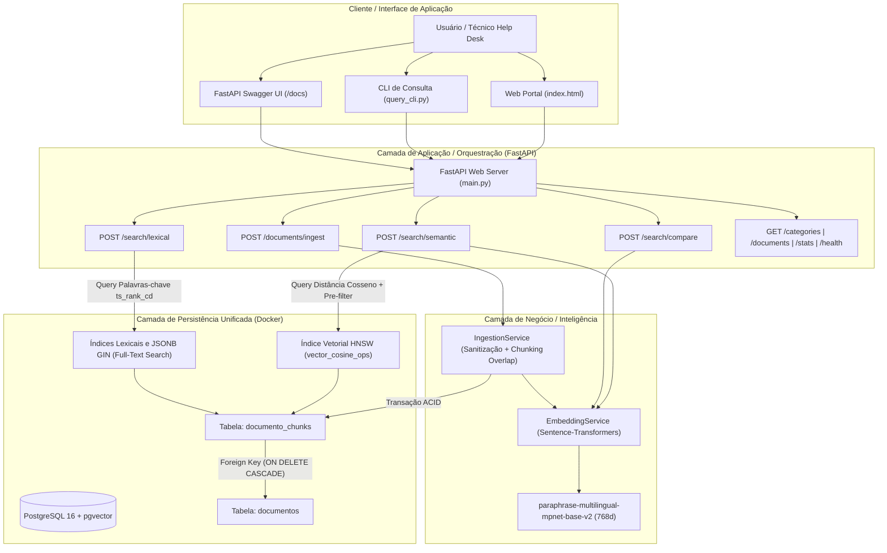

# Mecanismo de Busca Semântica para Help Desk com Armazenamento Vetorial em PostgreSQL

> **Trabalho de Conclusão de Curso (TCC 2) - Engenharia de Software**  
> **Universidade Tecnológica Federal do Paraná (UTFPR) - Campus Dois Vizinhos**  
> **Autor:** Matheus de Aquino da Silva  
> **Orientador:** Prof. Dr. Bruno Honorato  

Este projeto implementa e avalia empiricamente um mecanismo de busca semântica para bases de conhecimento corporativas de suporte técnico (*Help Desk*), integrando modelos neurais densos (*Sentence-Transformers*) à persistência e indexação relacional/vetorial unificada do **PostgreSQL 16** com a extensão **pgvector** e índices **HNSW** (*Hierarchical Navigable Small World*).

---

## 1. Visão Geral da Arquitetura

O sistema adota uma Arquitetura em Três Camadas (*Layered Architecture*), assegurando baixo acoplamento e alta coesão:



---

## 2. Requisitos Funcionais Atendidos

| Identificador | Nome do Requisito | Status | Implementação |
| :---: | :--- | :---: | :--- |
| **RF01** | Ingestão de Datasets | **Concluído** | Leitura e extração de 100 FAQs Microsoft e 100 Logs técnicos Ubuntu nos formatos JSON e CSV (`ingestion_service.py`). |
| **RF02** | Fragmentação de Texto (Chunking) | **Concluído** | Higienização textual e segmentação estruturada com sobreposição (`max_chars=260, overlap=50`), gerando 455 fragmentos contextualizados. |
| **RF03** | Geração de Embeddings | **Concluído** | Invocação do modelo `paraphrase-multilingual-mpnet-base-v2` (768 dimensões, normalizado L2) em lote e em tempo real. |
| **RF04** | Busca Vetorial Híbrida e Semântica | **Concluído** | Consultas por proximidade espacial via operador `<=>` (distância de cosseno) sobre índice HNSW combinadas com pré-filtragem relacional. |
| **RF05** | Busca Lexical (Grupo de Controle) | **Concluído** | Consultas Full-Text Search nativas do PostgreSQL (`to_tsvector`, `plainto_tsquery` e `ts_rank_cd`) com índices GIN em português e inglês. |
| **RF06** | Ranqueamento Top-N | **Concluído** | Ordenação ascendente por distância angular de cosseno com deduplicação documental, retornando os $N$ manuais mais relevantes. |
| **RF07** | Filtragem Relacional de Metadados | **Concluído** | Cláusulas de pré-filtragem por categoria técnica (`c.categoria`), fonte (`d.fonte`) e tags JSONB (`c.metadados->'tags'`). |

---

## 3. Estrutura de Diretórios

```text
c:\tcc\
├── docker-compose.yml            # Orquestração do PostgreSQL 16 + extensão pgvector
├── requirements.txt              # Dependências Python (FastAPI, Sentence-Transformers, pgvector, scipy, etc.)
├── README.md                     # Documentação completa de uso e arquitetura
├── sql/
│   └── init.sql                  # DDL do banco (tabelas documentos, documento_chunks e índices HNSW, B-Tree e GIN)
├── data/
│   ├── raw/                      # 100 FAQs Microsoft e 100 Logs técnicos Ubuntu em JSON e CSV
│   │   ├── microsoft_faq.json
│   │   ├── microsoft_faq.csv
│   │   ├── ubuntu_logs.json
│   │   └── ubuntu_logs.csv
│   ├── ground_truth.json         # Matriz de 60 consultas analíticas com gabarito binário (JSON)
│   └── ground_truth.csv          # Matriz de 60 consultas analíticas com gabarito binário (CSV)
├── app/
│   ├── main.py                   # Ponto de entrada FastAPI e rotas REST documentadas via OpenAPI/Swagger
│   ├── config.py                 # Configurações do projeto e variáveis de ambiente
│   ├── database.py               # Gerenciador de conexão persistente thread-safe com PostgreSQL e pgvector
│   ├── templates/
│   │   └── index.html            # Interface Web interativa com modo comparativo lado a lado
│   ├── models/
│   │   └── schemas.py            # Schemas Pydantic de validação de entrada, saída e telemetria
│   └── services/
│       ├── embedding_service.py  # Singleton de inferência do modelo Sentence-Transformers (768d)
│       ├── ingestion_service.py  # Pipeline de leitura JSON/CSV, sanitização, chunking e persistência
│       └── search_service.py     # Motores de busca semântica, lexical, híbrida e estatísticas do banco
├── scripts/
│   ├── generate_datasets.py      # Geração dos datasets (JSON/CSV) e do padrão-ouro de 60 consultas
│   ├── ingest_and_embed.py       # Pipeline de higienização, chunking, vetorização e carga inicial no banco
│   ├── evaluate_benchmark.py     # Bateria experimental automatizada, testes estatísticos (t-test/Wilcoxon) e gráficos
│   ├── query_cli.py              # Utilitário CLI interativo para testar consultas manuais
│   └── start_api.py              # Inicializador do servidor web FastAPI
├── tests/
│   ├── test_unit.py              # Testes unitários (sanitização, chunking, CSV/JSON, vetores 768d e Pydantic)
│   ├── test_persistence.py       # Testes de integração com o banco (DDL, índices HNSW/GIN, FK cascade e <=>)
│   └── test_api.py               # Testes de sistema dos endpoints REST (FastAPI TestClient)
└── results/
    ├── benchmark_resumo.csv      # Métricas consolidadas (Lexical Estrita, Lexical Flexível, Semântica e Híbrida)
    ├── benchmark_cenarios.csv    # Métricas discriminadas por cenário (Microsoft vs Ubuntu)
    ├── benchmark_detalhado.json  # Resultados analíticos de cada uma das 60 consultas
    ├── indexing_telemetry.json   # Telemetria do custo temporal de indexação (T_idx)
    ├── statistical_tests.json    # Resultados dos testes t de Student e Wilcoxon Signed-Rank
    └── relatorio_experimental.md # Relatório acadêmico completo formatado em Markdown
```

---

## 4. Guia Passo a Passo para Executar o Projeto

### Passo 1: Subir a Infraestrutura do Banco (PostgreSQL + pgvector)
Com o Docker Desktop em execução, rode no terminal:
```bash
docker compose up -d
```
> O container `tcc_postgres_vector` subirá na porta `5432` com a extensão vetorial e as tabelas/índices criados via `sql/init.sql`.

### Passo 2: Ativar o Ambiente Virtual Python
```powershell
.\.venv\Scripts\Activate.ps1
```

### Passo 3: Executar a Carga Inicial de Dados e Vetorização
```bash
python scripts/ingest_and_embed.py
```
> Lê os 200 documentos técnicos (JSON e CSV), executa a limpeza e o *chunking* com sobreposição (gerando 455 fragmentos), computa os embeddings vetoriais de 768 dimensões e persiste tudo no PostgreSQL ($T_{idx} \approx 9,31\text{ s}$).

### Passo 4: Executar a Bateria Experimental (Precision@5, Recall@5, MRR, Testes de Hipóteses e Telemetria)
```bash
python scripts/evaluate_benchmark.py
```
> Dispara as 60 consultas analíticas contra os motores lexical (estrito e disjuntivo) e semântico (HNSW puro e HNSW híbrido com pré-filtragem), calcula as métricas contra o Padrão-Ouro, executa os testes estatísticos de *Student* e *Wilcoxon*, coleta telemetria via `docker stats` e salva os relatórios e gráficos em `results/`.

### Passo 5: Iniciar o Servidor e Acessar a Interface Web / API
```bash
python scripts/start_api.py
```
Endpoints disponíveis:
* **Interface Web Interativa:** `http://localhost:8000/`
* **Swagger UI (OpenAPI):** `http://localhost:8000/docs`
* **Saúde e Índices (`GET /health`):** `http://localhost:8000/health`
* **Estatísticas do SGBD (`GET /stats`):** `http://localhost:8000/stats`
* **Catálogo de Categorias (`GET /categories`):** `http://localhost:8000/categories`
* **Catálogo de Documentos (`GET /documents`):** `http://localhost:8000/documents`
* **Ingestão em Tempo Real (`POST /documents/ingest`):** `http://localhost:8000/documents/ingest`
* **Busca Semântica (`POST /search/semantic`):** `http://localhost:8000/search/semantic`
* **Busca Lexical (`POST /search/lexical`):** `http://localhost:8000/search/lexical`
* **Comparação Lado a Lado (`POST /search/compare`):** `http://localhost:8000/search/compare`

### Passo 6: Rodar a Suíte Completa de Testes Automatizados (23 Testes)
```bash
pytest -v
```

---

## 5. Resumo dos Resultados Experimentais Obtidos

| Abordagem | Hits@1 | Precisão@5 | Revocação@5 | MRR | $T_{emb}$ Médio | $T_{sql}$ Médio | $T_{total}$ Médio | Consumo RAM Docker |
| :--- | :---: | :---: | :---: | :---: | :---: | :---: | :---: | :---: |
| **Busca Lexical Estrita (FTS Conjuntivo AND)** | 0.0000 | 0.0000 | 0.0000 | 0.0000 | 0.00 ms | 17.31 ms | 17.31 ms | ~44.96 MiB |
| **Busca Lexical Flexível (FTS Disjuntivo OR / GIN)** | 0.4833 | 0.1500 | 0.7500 | 0.5919 | 0.00 ms | 32.92 ms | 32.92 ms | ~44.96 MiB |
| **Busca Semântica Vetorial (pgvector HNSW 768d)** | **0.8333** | **0.1933** | **0.9667** | **0.8944** | 14.31 ms | **2.56 ms** | **16.87 ms** | ~44.96 MiB |
| **Busca Semântica Híbrida (HNSW + Pre-filtering RF07)** | **0.8500** | **0.2000** | **1.0000** | **0.9139** | 13.13 ms | **1.69 ms** | **14.81 ms** | ~44.96 MiB |

> **Destaques Científicos e de Engenharia de Software:**
> 1. **Eficácia Semântica Superior:** A Busca Semântica HNSW alcançou **96,67% de Revocação@5** e **0,8944 de MRR**, chegando a **100% de Revocação@5** e **0,9139 de MRR** na abordagem Híbrida com pré-filtragem relacional (RF07), superando o melhor baseline lexical (0,5919 de MRR) com significância estatística comprovada ($t = 5,2027$, $p = 2,59 \times 10^{-6}$; Wilcoxon $W = 49,0$, $p = 1,65 \times 10^{-5}$).
> 2. **Performance em Tempo Real:** Com reutilização de conexão persistente e o índice em grafo HNSW, o tempo médio de varredura vetorial no PostgreSQL ($T_{sql}$) foi de apenas **2,56 ms** (e **1,69 ms** com pré-filtro relacional), resultando em uma latência total média ($T_{total}$) de **14,81 ms a 16,87 ms**.
> 3. **Eficiência de Recursos:** O container `pgvector/pgvector:pg16` operou com alocação estável de apenas **44,96 MiB de RAM** (0,29% da memória disponível) e **0,08% de CPU**, validando a arquitetura relacional/vetorial unificada.
