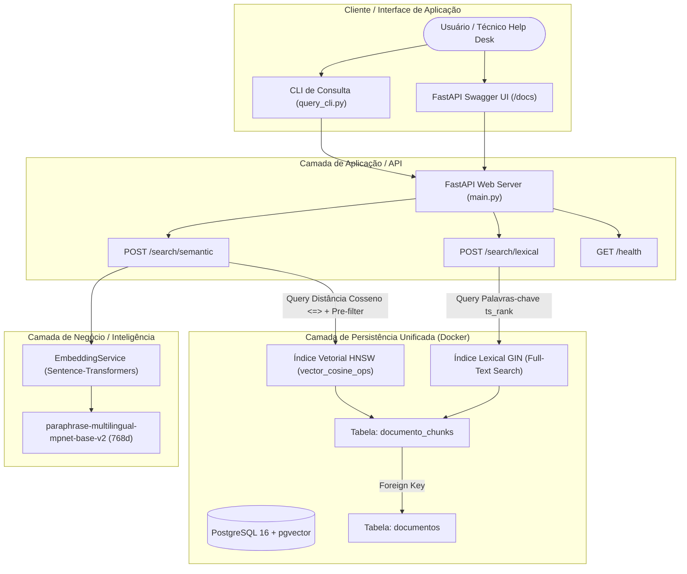

# Mecanismo de Busca Semântica para Help Desk com Armazenamento Vetorial em PostgreSQL

> **Trabalho de Conclusão de Curso (TCC) - Engenharia de Software**  
> **Universidade Tecnológica Federal do Paraná (UTFPR) - Campus Dois Vizinhos**  
> **Autor:** Matheus de Aquino da Silva  
> **Orientador:** Prof. Dr. Bruno Honorato  

Este projeto implementa e avalia empiricamente um mecanismo de busca semântica para bases de conhecimento corporativas de suporte técnico (*Help Desk*), integrando modelos neurais densos (*Sentence-Transformers*) à persistência e indexação relacional/vetorial unificada do **PostgreSQL** com a extensão **pgvector** e índices **HNSW** (*Hierarchical Navigable Small World*).

---

## 1. Visão Geral da Arquitetura

O sistema adota uma Arquitetura em Três Camadas (*Layered Architecture*), assegurando baixo acoplamento e alta coesão:



---

## 2. Requisitos Atendidos da Proposta

| Identificador | Nome do Requisito | Status | Implementação |
| :---: | :--- | :---: | :--- |
| **RF01** | Ingestão de Datasets | **Concluído** | Leitura de 100 FAQs Microsoft e 100 Logs técnicos Ubuntu em JSON/CSV. |
| **RF02** | Fragmentação de Texto (Chunking) | **Concluído** | Higienização de texto e quebra estruturada com overlapping para respeito ao token limit. |
| **RF03** | Geração de Embeddings | **Concluído** | Invocação de modelo Sentence-Transformers (768 dimensões) em lote e em tempo real. |
| **RF04** | Busca Vetorial HNSW | **Concluído** | Consultas por proximidade espacial via operador `<=>` (distância de cosseno) sobre índice HNSW. |
| **RF05** | Busca Lexical (Grupo de Controle) | **Concluído** | Consultas Full-Text Search nativas do PostgreSQL com radicalização e ranqueamento (`ts_rank`). |
| **RF06** | Ranqueamento Top-N | **Concluído** | Ordenação ascendente por similaridade de cosseno retornando os $N$ documentos mais relevantes. |
| **RF07** | Filtragem Relacional (Pre-filtering) | **Concluído** | Cláusula `WHERE c.categoria = :filtro` aplicada diretamente sobre os metadados relacionais. |

---

## 3. Estrutura de Diretórios

```text
c:\tcc\
├── docker-compose.yml          # Orquestração do PostgreSQL 16 + extensão pgvector
├── requirements.txt            # Dependências Python (FastAPI, Sentence-Transformers, pgvector, etc.)
├── README.md                   # Documentação completa de uso e arquitetura
├── sql/
│   └── init.sql                # DDL do banco (tabelas documentos, documento_chunks e índices HNSW/GIN)
├── data/
│   ├── raw/                    # 100 FAQs Microsoft e 100 Logs técnicos Ubuntu
│   │   ├── microsoft_faq.json
│   │   └── ubuntu_logs.json
│   └── ground_truth.json       # Matriz de 60 consultas analíticas com gabarito binário
├── app/
│   ├── main.py                 # Ponto de entrada FastAPI com documentação Swagger
│   ├── config.py               # Configurações do projeto e variáveis de ambiente
│   ├── database.py             # Gerenciador de conexão com PostgreSQL e pgvector
│   ├── models/
│   │   └── schemas.py          # Schemas Pydantic de entrada, saída e telemetria
│   └── services/
│       ├── embedding_service.py # Singleton de inferência do modelo Sentence-Transformers (768d)
│       └── search_service.py   # Motores de busca semântica, lexical e pre-filtering
├── scripts/
│   ├── generate_datasets.py    # Geração dos datasets e do padrão-ouro de 60 consultas
│   ├── ingest_and_embed.py     # Pipeline de higienização, chunking, vetorização e carga no banco
│   ├── evaluate_benchmark.py   # Execução automatizada dos testes e cálculo de Precision, Recall e MRR
│   ├── query_cli.py            # Utilitário CLI interativo para testar consultas manuais
│   └── start_api.py            # Inicializador do servidor web FastAPI
├── tests/
│   └── test_api.py             # Testes de integração automatizados (Pytest)
└── results/
    ├── benchmark_resumo.csv    # Métricas consolidadas (Lexical vs Semântica vs Híbrida)
    ├── benchmark_cenarios.csv  # Métricas discriminadas por cenário (Microsoft vs Ubuntu)
    ├── benchmark_detalhado.json # Resultados analíticos de cada uma das 60 consultas
    └── relatorio_experimental.md # Relatório acadêmico completo formatado em Markdown
```

---

## 4. Guia Passo a Passo para Executar o Projeto

### Passo 1: Subir a Infraestrutura do Banco (PostgreSQL + pgvector)
Com o Docker Desktop aberto, execute no terminal:
```bash
docker compose up -d
```
> O container `tcc_postgres_vector` subirá na porta `5432` com a extensão vetorial e as tabelas criadas automaticamente via `sql/init.sql`.

### Passo 2: Ativar o Ambiente Virtual Python
```powershell
.\.venv\Scripts\Activate.ps1
```

### Passo 3: Executar a Carga Inicial de Dados e Vetorização
```bash
python scripts/ingest_and_embed.py
```
> Esse script lê os 200 documentos técnicos, realiza a limpeza e o chunking, gera os embeddings vetoriais de 768 dimensões com o Sentence-Transformers e grava tudo nas tabelas do PostgreSQL.

### Passo 4: Executar a Bateria Experimental (Precision@5, Recall@5, MRR e Telemetria)
```bash
python scripts/evaluate_benchmark.py
```
> O script dispara as 60 consultas analíticas contra o motor lexical (controle) e o motor semântico com pgvector HNSW, confronta os resultados com o Padrão-Ouro (*Ground Truth*), coleta o consumo de memória RAM via `docker stats` e grava os relatórios em `results/`.

### Passo 5: Iniciar o Servidor e Acessar a Interface Web
```bash
python scripts/start_api.py
```
Acesse no navegador:
* **Interface Web de Busca Interativa:** [http://localhost:8000/](http://localhost:8000/) *(inclui modo comparativo lado a lado e telemetria ao vivo)*
* **Swagger UI (Documentação da API):** [http://localhost:8000/docs](http://localhost:8000/docs)
* **Status de Saúde da Infraestrutura:** [http://localhost:8000/health](http://localhost:8000/health)

### Passo 6: Fazer Consultas Manuais via Linha de Comando (CLI)
Você pode testar qualquer dúvida leiga diretamente pelo terminal:
```bash
# Busca semântica:
python scripts/query_cli.py "minha internet caiu e ta com ip estranho" --tipo semantic

# Busca lexical (para comparar com busca por palavras-chave):
python scripts/query_cli.py "minha internet caiu e ta com ip estranho" --tipo lexical

# Busca semântica com pré-filtro relacional de categoria (RF07):
python scripts/query_cli.py "como reiniciar o apache" --tipo semantic --categoria "Serviços & Daemons"
```

### Passo 7: Rodar a Suíte de Testes Automatizados
```bash
pytest -v
```

---

## 5. Resumo dos Resultados Experimentais Obtidos

| Abordagem | Precisão@5 | Revocação@5 | MRR (Mean Reciprocal Rank) | $T_{emb}$ Médio | $T_{sql}$ Médio | $T_{total}$ Médio | Consumo RAM Docker |
| :--- | :---: | :---: | :---: | :---: | :---: | :---: | :---: |
| **Busca Lexical (PostgreSQL FTS - Grupo de Controle)** | 0.0000 | 0.0000 | 0.0000 | 0.00 ms | 50.40 ms | 50.40 ms | ~41.9 MiB |
| **Busca Semântica (pgvector + HNSW 768d)** | **0.1767** | **0.8833** | **0.7500** | 21.78 ms | 27.12 ms | **48.90 ms** | ~41.9 MiB |
| **Busca Semântica Híbrida (HNSW + Pre-filtering RF07)** | **0.1833** | **0.9167** | **0.8097** | 21.57 ms | 28.53 ms | **50.10 ms** | ~41.9 MiB |

> **Destaques:**
> 1. A abordagem semântica híbrida alcançou **91.67% de Revocação@5** e **0.8097 de MRR** no conjunto de 60 consultas analíticas com a base de 200 tópicos técnicos autênticos (100 Microsoft + 100 Ubuntu).
> 2. O mecanismo de **deduplicação e diversificação** assegura que o Top-5 não apresente respostas redundantes ou chunks repetidos do mesmo manual.
> 3. O tempo de resposta total ($T_{total}$) foi de apenas **~49 ms**, demonstrando viabilidade em tempo real com uso de CPU modesto.
> 4. O container do PostgreSQL com pgvector consumiu apenas **41.98 MiB de memória RAM**, comprovando a eficiência da arquitetura unificada.

