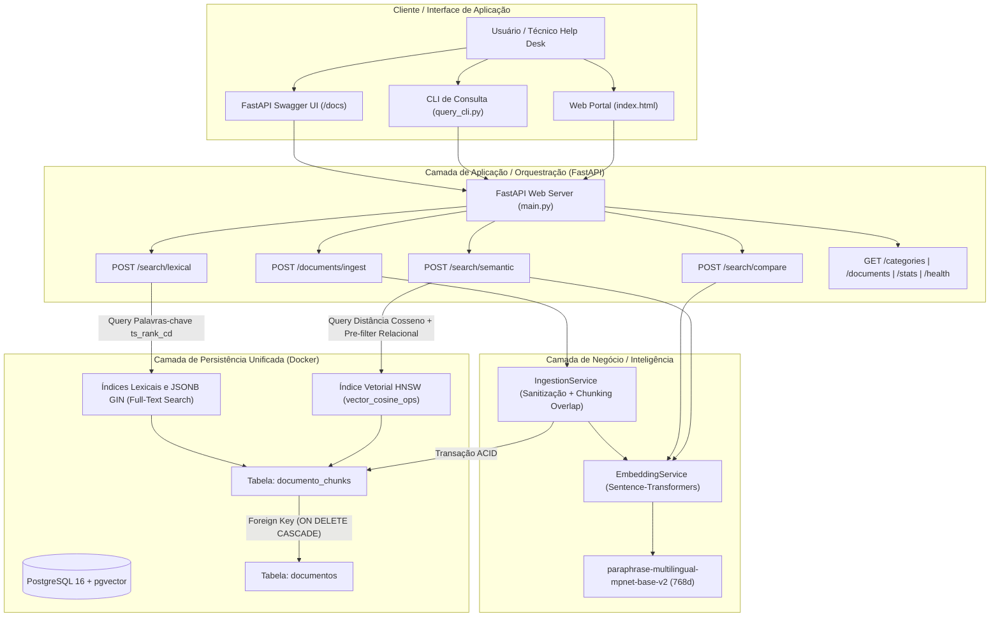

# Mecanismo de Busca Semântica para Aplicações Web com Armazenamento Vetorial em PostgreSQL

> **Trabalho de Conclusão de Curso (TCC 2) - Bacharelado em Engenharia de Software**  
> **Universidade Tecnológica Federal do Paraná (UTFPR) - Câmpus Dois Vizinhos**  
> **Autor:** Matheus de Aquino da Silva  
> **Orientador:** Prof. Dr. Bruno Honorato  

Este repositório reúne a implementação, os conjuntos de dados (brutos e fragmentados), a matriz de Padrão-Ouro (*Ground Truth*), os scripts de avaliação experimental, os resultados estatísticos e as evidências da suíte de 23 testes automatizados do mecanismo de busca semântica para bases de conhecimento de suporte técnico (*Help Desk*), integrando modelos neurais densos (*Sentence-Transformers*) à persistência relacional e vetorial unificada do **PostgreSQL 16** com a extensão **pgvector** e índices **HNSW** (*Hierarchical Navigable Small World*).

---

## 1. Visão Geral da Arquitetura

O sistema adota uma Arquitetura em Três Camadas (*Layered Architecture*), assegurando baixo acoplamento e alta coesão entre os subsistemas:



---

## 2. Requisitos Funcionais Atendidos

| Identificador | Nome do Requisito | Status | Implementação |
| :---: | :--- | :---: | :--- |
| **RF01** | Ingestão de Datasets | **Concluído** | Leitura e extração de 100 FAQs Microsoft e 100 Logs técnicos Ubuntu nos formatos JSON e CSV (`app/services/ingestion_service.py`). |
| **RF02** | Fragmentação de Texto (*Chunking*) | **Concluído** | Higienização textual e segmentação estruturada com sobreposição (`max_chars=260, overlap=50`), gerando 455 fragmentos contextualizados (`data/processed/`). |
| **RF03** | Geração de Embeddings | **Concluído** | Invocação do modelo `paraphrase-multilingual-mpnet-base-v2` (768 dimensões, normalizado $L_2$) em lote e em tempo real (`app/services/embedding_service.py`). |
| **RF04** | Busca Vetorial Semântica e com Pré-filtragem | **Concluído** | Consultas por proximidade espacial via operador `<=>` (distância de cosseno) sobre índice HNSW combinadas opcionalmente com predicados relacionais (`app/services/search_service.py`). |
| **RF05** | Busca Lexical (Grupo de Controle) | **Concluído** | Consultas *Full-Text Search* nativas do PostgreSQL (`to_tsvector`, `plainto_tsquery` e `ts_rank_cd`) com índices GIN em português e inglês. |
| **RF06** | Ranqueamento Top-N e Deduplicação | **Concluído** | Ordenação ascendente por distância angular de cosseno com deduplicação por `documento_id`, retornando os $N$ manuais distintos mais relevantes. |
| **RF07** | Pré-filtragem Relacional de Metadados | **Concluído** | Cláusulas estruturadas de pré-filtragem por categoria técnica (`c.categoria` via B-Tree), fonte (`d.fonte`) e tags JSONB (`c.metadados->'tags'` via GIN). |

> **Nota Conceitual Importante (Pré-filtragem Relacional vs. Busca Híbrida Lexical-Vetorial):**  
> Neste trabalho, a integração entre filtros estruturados (`WHERE c.categoria = :filtro`) e busca vetorial HNSW (`ORDER BY c.embedding <=> :vetor`) é denominada **Busca Semântica com Pré-filtragem Relacional (*Filtered Vector Search*)**. Ela difere conceitualmente de uma **Busca Híbrida Lexical-Vetorial (*Sparse-Dense Hybrid Search*)**, a qual combina escores lexicais (BM25/FTS) e vetoriais (cosseno) via métodos de fusão de ranking como *Reciprocal Rank Fusion* (RRF).

---

## 3. Organização Completa do Repositório

```text
c:\tcc\
├── docker-compose.yml                        # Orquestração do PostgreSQL 16 + extensão pgvector
├── requirements.txt                          # Dependências Python fixadas para reprodutibilidade
├── README.md                                 # Guia geral de arquitetura, execução e validação experimental
├── sql/
│   └── init.sql                              # DDL do banco (tabelas documentos, documento_chunks e índices HNSW, B-Tree e GIN)
├── data/
│   ├── README.md                             # Documentação metodológica dos datasets e do Padrão-Ouro
│   ├── raw/                                  # Datasets brutos: 100 FAQs Microsoft e 100 Logs Ubuntu (JSON e CSV)
│   │   ├── microsoft_faq.json
│   │   ├── microsoft_faq.csv
│   │   ├── ubuntu_logs.json
│   │   └── ubuntu_logs.csv
│   ├── processed/                            # 455 fragmentos (chunks) higienizados e segmentados com overlap
│   │   ├── chunks_indexados.json
│   │   └── chunks_indexados.csv
│   ├── ground_truth.json                     # Matriz de Padrão-Ouro com 60 consultas analíticas rotuladas (JSON)
│   └── ground_truth.csv                      # Matriz de Padrão-Ouro com 60 consultas analíticas rotuladas (CSV)
├── app/
│   ├── main.py                               # Ponto de entrada FastAPI e 11 rotas REST documentadas via OpenAPI/Swagger
│   ├── config.py                             # Configurações do projeto e variáveis de ambiente
│   ├── database.py                           # Gerenciador de conexão persistente thread-safe com PostgreSQL e pgvector
│   ├── templates/
│   │   └── index.html                        # Interface Web interativa com modo comparativo lado a lado
│   ├── models/
│   │   └── schemas.py                        # Schemas Pydantic de validação de entrada, saída e telemetria
│   └── services/
│       ├── embedding_service.py              # Singleton de inferência do modelo Sentence-Transformers (768d)
│       ├── ingestion_service.py              # Pipeline de leitura JSON/CSV, sanitização, chunking e persistência
│       └── search_service.py                 # Motores de busca semântica (pura e pré-filtrada), lexical e estatísticas
├── scripts/
│   ├── generate_datasets.py                  # Geração reprodutível dos datasets (200 docs) e do Padrão-Ouro (60 consultas)
│   ├── ingest_and_embed.py                   # Pipeline de sanitização, chunking, vetorização em lote e carga no PostgreSQL
│   ├── evaluate_benchmark.py                 # Bateria experimental, ablação lexical, testes estatísticos (t/Wilcoxon) e gráficos
│   ├── query_cli.py                          # Utilitário CLI interativo para execução de consultas manuais
│   └── start_api.py                          # Inicializador do servidor web FastAPI (porta 8000)
├── tests/
│   ├── test_unit.py                          # 8 Testes unitários (sanitização, chunking, CSV/JSON, vetores 768d e Pydantic)
│   ├── test_persistence.py                   # 5 Testes de integração com o SGBD (DDL, índices HNSW/GIN, FK cascade e <=>)
│   └── test_api.py                           # 10 Testes de sistema dos endpoints REST (FastAPI TestClient)
├── results/
│   ├── benchmark_resumo.csv                  # Métricas globais consolidadas (Hits@1, Precisão@5, Revocação@5, MRR e latências)
│   ├── benchmark_cenarios.csv                # Métricas estratificadas por cenário (Microsoft vs Ubuntu)
│   ├── benchmark_detalhado.json              # Resultados individuais de cada uma das 60 consultas nos 4 modos avaliados
│   ├── lexical_baseline_investigation.json   # Diagnóstico empírico de ablação do baseline lexical estrito (MRR = 0)
│   ├── indexing_telemetry.json               # Telemetria do custo temporal de indexação (T_idx)
│   ├── statistical_tests.json                # Resultados e interpretação dos testes t de Student e Wilcoxon Signed-Rank
│   ├── relatorio_experimental.md             # Relatório experimental consolidado em Markdown
│   ├── evidencias_testes.md                  # Matriz rastreável e documentação das evidências dos 23 testes automatizados
│   ├── pytest_evidencias.txt                 # Log integral de console da execução dos 23 testes automatizados (100% PASSED)
│   ├── pytest_junit.xml                      # Relatório formal em padrão JUnit XML dos 23 testes automatizados
│   ├── der_persistencia.png                  # Diagrama Entidade-Relacionamento físico das tabelas
│   ├── grafico_metricas_globais.png          # Gráfico comparativo global (Precisão@5, Revocação@5 e MRR)
│   ├── grafico_cenarios.png                  # Gráfico comparativo estratificado por cenário (Microsoft vs Ubuntu)
│   └── grafico_latencia.png                  # Gráfico de decomposição de latência (T_emb + T_sql)
└── Template-Relatório-Técnico-BES-UTFPR/     # Código-fonte LaTeX e PDF compilado da monografia do TCC 2
```

---

## 4. Instruções Passo a Passo de Execução e Reprodutibilidade

### Pré-requisitos
* **Docker Desktop** (para execução do container `pgvector/pgvector:pg16` na porta `5432`)
* **Python 3.11+**

### Passo 1: Iniciar o Banco de Dados (PostgreSQL 16 + pgvector)
```powershell
docker compose up -d
```
> Inicializa o container `tcc_postgres_vector` na porta `5432` e executa automaticamente o script `sql/init.sql` (criação da extensão `vector`, tabelas `documentos` e `documento_chunks`, índice HNSW, índices B-Tree e índices GIN).

### Passo 2: Configurar/Ativar o Ambiente Virtual Python
```powershell
.\.venv\Scripts\Activate.ps1
# Caso deseje reinstalar as dependências em um novo ambiente:
# pip install -r requirements.txt
```

### Passo 3: (Opcional) Regerar os Datasets Brutos e a Matriz de Padrão-Ouro
```powershell
python scripts/generate_datasets.py
```
> Recria deterministicamente os 200 documentos técnicos em `data/raw/` (JSON e CSV) e as 60 consultas analíticas rotuladas em `data/ground_truth.json` e `data/ground_truth.csv`.

### Passo 4: Executar a Pipeline de Ingestão, Chunking e Vetorização em Lote
```powershell
python scripts/ingest_and_embed.py
```
> Extrai os 200 documentos (Microsoft JSON + Ubuntu CSV), aplica sanitização e *chunking* com sobreposição (`max_chars=260, overlap=50`), exporta os **455 fragmentos** para `data/processed/`, gera os vetores densos de 768 dimensões e persiste tudo no PostgreSQL ($T_{idx} \approx 9,31\text{ s}$).

### Passo 5: Executar a Suíte de 23 Testes Automatizados e Gerar Evidências
```powershell
pytest -v -rA --junitxml=results/pytest_junit.xml
```
> Executa os **23 testes automatizados** (`8` unitários em `tests/test_unit.py`, `5` de persistência em `tests/test_persistence.py` e `10` de API em `tests/test_api.py`). As evidências salvas encontram-se em [`results/evidencias_testes.md`](./results/evidencias_testes.md), [`results/pytest_evidencias.txt`](./results/pytest_evidencias.txt) e [`results/pytest_junit.xml`](./results/pytest_junit.xml).

### Passo 6: Executar a Bateria Experimental, Ablação Lexical e Testes Estatísticos
```powershell
python scripts/evaluate_benchmark.py
```
> Executa as 60 consultas do Padrão-Ouro sobre as 4 configurações avaliadas, conduz a investigação de ablação do baseline lexical (`results/lexical_baseline_investigation.json`), aplica os testes pareados $t$ de Student e Wilcoxon (`results/statistical_tests.json`), atualiza os gráficos científicos e gera `results/relatorio_experimental.md`.

### Passo 7: Iniciar a API FastAPI e Interface Web Interativa
```powershell
python scripts/start_api.py
```
* **Portal Web Comparativo:** `http://localhost:8000/`
* **Documentação OpenAPI (Swagger UI):** `http://localhost:8000/docs`
* **Utilitário de Consulta via CLI:**
  ```powershell
  python scripts/query_cli.py "minha internet nao funciona e aparece rede nao identificada" --tipo semantic
  ```

---

## 5. Metodologia Experimental e Resumo Consolidado dos Resultados

### 5.1 Construção do Padrão-Ouro (60 Consultas) e Justificativa de 1 Documento Relevante ($|Rel_q| = 1$)
* **Paradigma *Known-Item Search* (Busca por Item Conhecido):** O corpus de 200 documentos técnicos foi elaborado sob exclusividade temática (*Knowledge-Centered Service* — KCS), onde cada documento descreve o diagnóstico e a solução canônica de um único incidente técnico distinto (100 FAQs Microsoft e 100 logs Ubuntu).
* **Formulação e Determinação de Relevância:** Selecionou-se uma amostra estratificada de 60 documentos-alvo (30 Microsoft e 30 Ubuntu). Para cada um, formulou-se uma consulta em linguagem natural baseada na descrição do **sintoma pelo usuário**, omitindo deliberadamente os comandos técnicos da solução e os acentos ortográficos. Um documento recebe relevância binária $R = 1$ se, e somente se, seu procedimento técnico resolve a causa-raiz descrita na consulta (verificado por auditoria cruzada contra os demais 199 documentos).
* **Teto Teórico da Precisão@5:** Como $|Rel_q| = 1$ para cada consulta, no corte *Top-5* ($N = 5$) o valor máximo atingível por $\text{Precisão@5}$ é $1/5 = 0,2000$ ($20,00\%$), enquanto $\text{Revocação@5}$, $\text{Hits@1}$ e $\text{MRR}$ têm limite superior igual a $1,0000$.

### 5.2 Tabela Global de Resultados Experimentais (60 Consultas)

| Abordagem Avaliada | Hits@1 | Precisão@5 (Teto=0,20) | Revocação@5 | MRR | $T_{emb}$ Médio | $T_{sql}$ Médio | $T_{total}$ Médio | Consumo RAM Docker |
| :--- | :---: | :---: | :---: | :---: | :---: | :---: | :---: | :---: |
| **Busca Lexical Estrita (FTS Conjuntivo AND)** | 0.0000 | 0.0000 | 0.0000 | 0.0000 | 0.00 ms | 17.31 ms | 17.31 ms | ~44.96 MiB |
| **Busca Lexical Flexível (FTS Disjuntivo OR / GIN)** | 0.4833 | 0.1500 | 0.7500 | 0.5919 | 0.00 ms | 32.92 ms | 32.92 ms | ~44.96 MiB |
| **Busca Semântica Vetorial Pura (pgvector HNSW)** | **0.8333** | **0.1933** | **0.9667** | **0.8944** | 14.31 ms | **2.56 ms** | **16.87 ms** | ~44.96 MiB |
| **Busca Semântica com Pré-filtragem Relacional (RF07)** | **0.8500** | **0.2000** | **1.0000** | **0.9139** | 13.13 ms | **1.69 ms** | **14.81 ms** | ~44.96 MiB |

### 5.3 Síntese das Conclusões Científicas e Limitações do Estudo
1. **Investigação do MRR = 0 na Busca Lexical Estrita e Representatividade dos Baselines:** A ablação empírica (`results/lexical_baseline_investigation.json`) revelou que as 60 consultas naturais possuem média de **6,42 radicais**, dos quais apenas **4,07 (63,4%)** ocorrem no manual relevante. Mesmo adicionando normalização diacrítica (`unaccent`) e concatenando o título ao fragmento, o operador booleano estrito `AND` recupera apenas **8/60 consultas ($\text{MRR} = 0,1333$)**, falhando em **86,67%** dos casos pela presença de verbos/substantivos coloquiais extras. Por essa razão, a **Busca Lexical Flexível Disjuntiva (`OR` + `ts_rank_cd` + GIN)** — que alcança **75,00% de Revocação@5** e **0,5919 de MRR** — foi estabelecida como o baseline lexical representativo para os testes estatísticos.
2. **Superioridade Estatisticamente Significativa sobre o Baseline Lexical ($\alpha = 0,01$):** Tanto a Busca Semântica Vetorial Pura ($t = 4,7757, p = 1,22 \times 10^{-5}$; Wilcoxon $W = 66,5, p = 6,22 \times 10^{-5}$) quanto a Busca Semântica com Pré-filtragem Relacional ($t = 5,2027, p = 2,59 \times 10^{-6}$; Wilcoxon $W = 49,0, p = 1,65 \times 10^{-5}$) superam o baseline lexical representativo com significância estatística ($p < 0,0001 \ll \alpha = 0,01$).
3. **Ausência de Diferença Estatisticamente Significativa entre Pré-filtragem Relacional e Semântica Pura:** Na comparação direta entre a Busca Semântica com Pré-filtragem Relacional ($\text{MRR} = 0,9139$) e a Busca Semântica Vetorial Pura ($\text{MRR} = 0,8944$), obtiveram-se $t = 1,8765$ ($p = 0,0655$) e Wilcoxon $W = 0,0$ ($p = 0,0656$). Como $p > \alpha = 0,01$ (e $p > 0,05$), **não há superioridade estatisticamente significativa** da pré-filtragem relacional sobre a busca semântica pura em MRR global. A contribuição comprovada da pré-filtragem relacional (RF07) concentra-se na redução de $34\%$ no tempo de varredura SQL ($1,69\text{ ms}$ contra $2,56\text{ ms}$) e na restrição determinística de escopo quando a categoria técnica do chamado é conhecida.
4. **Delimitação de Escopo Amostral (455 Fragmentos):** Os resultados de latência e consumo de memória ($44,96\text{ MiB}$) refletem um ambiente controlado de pequeno porte (**200 documentos / 455 fragmentos**), validando a viabilidade arquitetural do protótipo, mas sem permitir generalizações conclusivas sobre escalabilidade em bases massivas na casa de milhões de vetores.
